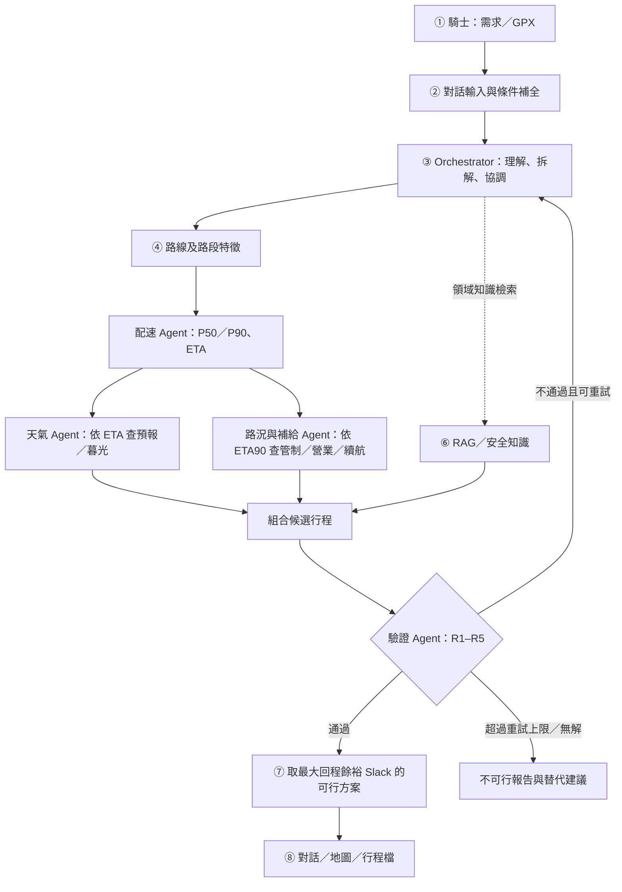

# 🏍️ 重機旅遊規劃顧問｜Moto Touring Copilot

> **以個人化配速預測、抵達時間窗分析與確定性驗證為核心的山區重機行前決策輔助系統**
>
> **專題階段：Proposal / Proposed Design（研究提案與系統設計）**  
> **文件用途：** 專題概述、架構說明、驗證規格、實驗規劃及後續開發交接  
> **重要聲明：** 下列模型、Agent、API 串接與實驗主要是**規劃中的設計**；本倉庫目前尚未提供可直接執行的系統原始碼或已完成的實測成果。此系統不取代官方交通資訊、導航或騎士判斷，也不承諾能保證行車安全。

---

## 01｜研究背景與問題定義（Problem）

依本專題提案引用的交通部統計，**2025 年臺灣道路交通事故 30 日內死亡人數為 2,858 人，其中機車事故死亡 1,740 人，占 60.9%**。山區重機旅遊面臨連續彎道、長距離坡道、午後雷雨、預警性封路、補給站稀疏及日照時間等限制。南橫台 20 線曾因豪雨引發落石、土石流風險而預警性封閉，顯示「地圖可達」不等於「預計抵達時仍可安全通行」。

傳統導航主要提供路線與單一預估到達時間（ETA），難反映**個別騎士**在彎道、坡度及休息習慣下的配速差異；天氣、路況、加油站營業與暮光資訊又分散在不同平台。LLM 雖適合自然語言理解及規劃協調，卻不宜單憑自身文字推理認定行程符合全部硬性限制。

**核心研究問題：** 如何將「個人配速的不確定性 → 逐路段預計抵達時窗 → 動態環境資料查詢 → 獨立規則驗證」整合為可解釋、可追溯且可拒絕不可行方案的行前決策流程？

## 02｜專題目標與三大亮點（Objectives & Highlights）

| 編號 | 技術亮點 | 解決的問題 |
|---|---|---|
| **H1** | **個人化配速 + P50／P90 + Conformal 校正** | 不只提供平均 ETA，也估計延誤情境下的整趟時間餘裕 |
| **H2** | **ETA 驅動的時間感知環境查詢** | 天氣、封路與補給資訊依「抵達該處時刻」評估，而非只看出發當下 |
| **H3** | **多 Agent 規劃與確定性驗證分離** | LLM 協調候選方案；Python 規則驗證硬性限制，不合格即退回重規劃 |

**預計輸出：** 建議出發時間、各路段／節點 P50 與 P90 ETA、風險路段、加油與休息建議、替代路線、回程餘裕（Slack）及可追溯的資料來源。若找不到可行方案，回報**不可行原因**，而非強行產生行程。

## 03｜使用情境與需求（Requirements）

**目標使用者：** 規劃臺灣山區中長距離旅遊的重機騎士，特別是需要考量日照、天氣及補給的單人行程。

**規劃輸入：**
- 自然語言：起點、目的地、途經點、日期、候選出發時間、最晚回程時間、風險偏好。
- 騎士資料：個人歷史 GPX 軌跡、車輛續航與補給偏好；缺少關鍵條件時先追問。
- 外部條件：道路幾何、地形、氣象、道路事件、營業資訊、民用暮光終。

**規劃輸出與原則：**
- 給出時間區間與決策依據，不只單點 ETA。
- 以較保守的 P90 情境檢核行程是否有足夠時間與續航。
- 每個數值標示來源、查詢時間和對應規則；資料不足或過期時，不假裝已驗證。
- 系統定位是**出發前的輔助決策**，不是事故預測系統，也不是實際道路通行的保證。

## 04｜①–⑧ 八大模組架構（System Modules）

| 模組 | 名稱 | 核心設計 |
|---|---|---|
| **①** | 使用者與情境（User & Context） | 山區重機騎乘、個人習慣、行程期限與風險偏好 |
| **②** | 問題輸入（Input） | 對話式行程需求、個人 GPX 匯入、缺漏條件追問 |
| **③** | Planner & Reasoning | Orchestrator 與配速、天氣、路況補給、驗證 Agent 協作 |
| **④** | 資料取得（Data Acquisition） | GPX、CWA、TDX、20m DTM、OSM、加油站、Routes API |
| **⑤** | Analytics Engine | LightGBM 分位數預測、Conformal 校正、確定性限制檢核 |
| **⑥** | Domain Knowledge | RAG 檢索行車安全、氣象警特報、道路資訊、車款規格 |
| **⑦** | 決策與建議（Decision） | 候選出發時間與行程比較、Slack 最佳化、風險／補給方案 |
| **⑧** | 輸出與互動（Output） | 多輪對話、地圖儀表板、可下載行程與決策依據 |

### 04.1｜多 Agent 規劃—驗證流程



> 設計原則：**LLM 負責理解與協調，領域工具負責計算與驗證（Planning ≠ Verification）。** 上述為預計實作的系統架構，非當前可執行流程截圖。

### 04.2｜五個 Agent 的責任

| Agent | 預計責任 |
|---|---|
| **A1 Orchestrator** | 解析自然語言、補全需求、派發任務、比較候選方案與重新規劃 |
| **A2 Pace Agent** | 根據個人配速模型預測路段 P50／P90 移動時間與各點 ETA |
| **A3 Weather Agent** | 按 ETA50／ETA90 對齊預報時段、降雨風險、警特報與暮光 |
| **A4 Road & Fuel Agent** | 按 ETA90 查 TDX 路況、加油站抵達時營業狀態與續航可達性 |
| **A5 Validator Agent** | 使用確定性 Python 規則執行 R1–R5，回傳違規原因與驗證結果 |

## 05｜資料來源與處理（Data Sources）

| 資料來源 | 預計用途 | 注意事項 |
|---|---|---|
| **個人 GPX（既有 279 趟歷史軌跡）** | 配速學習、停留習慣與行程回測 | 頭尾隱私裁切、跳點清理、分組驗證 |
| **中央氣象署 CWA** | 鄉鎮預報、降雨、警特報及時間相關資訊 | 保存預報時效與查詢時間 |
| **交通部 TDX** | 即時道路事件、封閉與管制 | 資料延遲及歷史事件缺漏需處理 |
| **內政部 20m DTM** | 坡度、地形起伏 | 地形解析度限制 |
| **OpenStreetMap（OSM）** | 道路幾何、曲率與道路等級 | 路網資料完整性需驗證 |
| **中油／加油站資訊** | 站點、營業時間、補給可達性 | 不應只依距離判斷可補給 |
| **Google Maps Routes API** | 候選路線及外部 ETA 比較 | 實際可用模式、授權與配額須依官方服務確認 |

**預計資料鏈：** GPX 匯入 → 住家附近頭尾裁切（TRIM_ENDS）→ 清理異常速度及時間 → 區分移動／停留 → 路段切分與路網匹配 → 建立坡度、曲率、道路等級等特徵 → 個人化模型與回測資料。

## 06｜Analytics Engine：個人化配速與不確定性

1. **模型：** 使用 LightGBM Quantile Loss，以 `q = 0.5`、`q = 0.9` 建立路段層級 P50／P90 移動時間預測；設計中的預測目標為路段移動時間對數 `log(t_i)`。
2. **校正：** 透過 **Conformal Prediction / Calibration** 檢查並調整整趟 P90 預測之覆蓋性，避免把逐段量化結果直接視為已保證的整趟上界。
3. **時間傳遞：** 依候選出發時刻推算各路段 `ETA50 / ETA90`，讓天氣、路況、營業與日照檢查使用相符的抵達時窗。
4. **評估切分：** 規劃以 **GroupKFold** 依「行程」分組，避免同一趟 GPX 的不同路段同時落入訓練與測試集；另進行時間外推及未見路線測試。
5. **決策：** 在通過安全限制的可行候選方案中，優先選擇回程時間餘裕 **Slack** 較大的方案。

> **P50**：典型情境的時間估計。**P90**：作為較保守決策基準的分位數估計；其實際覆蓋率須經回測驗證，不能直接當作安全保證。

## 07｜R1–R5 五大硬性驗證規則（Safety Constraints）

| 規則 | 驗證對象 | 預計判定方式 |
|---|---|---|
| **R1 日照／回程限制** | 整趟保守時間 | `d + T^(0.9) ≤ min(T_dusk, T_user)`，即 P90 回程時刻不得晚於暮光終或騎士設定期限 |
| **R2 續航與營業** | 加油點及燃油餘裕 | 相鄰補給距離 `≤ 可用續航 × (1 − 安全餘裕)`，且抵達站點的 `ETA90` 在營業時間內 |
| **R3 天氣風險** | 路段抵達時窗 | 遇大雨以上警特報標為高風險；高風險段不得安排於日照餘裕最緊的末段 |
| **R4 道路封閉／管制** | 候選路線 | 若 TDX 顯示相關封閉或管制事件，將受影響路段視為不可行，重新規劃 |
| **R5 數字可追溯** | 輸出數值與依據 | 所有時間、距離、機率與判斷可追溯至工具輸出、資料版本及查詢時間 |

**驗證結果：** `PASS` → 選取可行方案；`FAIL` → 附違規原因重新規劃；`NO_FEASIBLE_PLAN` → 說明無解條件與替代選項。任何缺漏、失效或過期資料的實際處理策略，仍須在開發時具體化並測試。

## 08｜兩套核心演算法（Algorithms）

### Algorithm 1｜Plan with Verification

```text
01 UNDERSTAND：解析騎士需求與限制；缺漏則詢問
02 BUILD_ROUTE：建立候選路線與途經點
03 SEGMENT_FEATURES：萃取路段坡度、曲率、道路類別
04 CANDIDATE_DEPARTURES：建立候選出發時間集合 D
05 對每個 d ∈ D：
06   PACE_AGENT → t50、t90、ETA50、ETA90
07   WEATHER_AGENT → 依抵達時窗查氣象與暮光
08   ROAD_FUEL_AGENT → 依 ETA90 查管制、營業、續航
09   COMPOSE_PLAN → 組合候選計畫與知識來源
10   VERIFY(plan) → 驗證 R1–R5
11   若通過且 Slack 更大 → 保存為 best
12 若所有候選均不合格 → REPLAN（至 MAX_ATTEMPTS）
13 若仍無解 → 輸出不可行報告及替代方案
14 否則 → 輸出最佳方案、ETA 區間、風險與資料來源
```

### Algorithm 2｜Personal Pace Model Update

```text
01 匯入 GPX → TRIM_ENDS 裁切頭尾隱私位置
02 清理異常 GPS 跳點、速度平滑
03 區分移動與停留時間
04 擷取坡度、曲率、道路等級等路段特徵
05 依整趟騎乘紀錄分組，建立 GroupKFold
06 訓練 LightGBM Quantile（q = 0.5 / 0.9）
07 估計 conformal 校正量 c_0.9
08 評估整趟 P90 覆蓋率與時間誤差，保存模型版本
```

上述為研究提案中的**演算法設計／偽程式碼**，尚不是已上線程式的使用說明。

## 09｜M1–M5 五大領域決策思維（Domain Knowledge）

| 思維 | 核心問題 | 系統對應 |
|---|---|---|
| **M1 最難路段優先** | 平均車速會掩蓋急彎、爬坡的慢速路段 | 分段 P50／P90，決策採 P90 |
| **M2 山區天氣看時間窗** | 騎士抵達時是否遇到午後雷雨？ | 依 ETA 查詢分時預報與警特報 |
| **M3 日照與騎乘時數是限制** | 是否能在騎士設定期限及暮光終前回程？ | R1 日照檢核、加入休息安排 |
| **M4 補給看抵達時狀態** | 加油站在 ETA90 時仍營業嗎？ | R2 營業時間與續航檢核 |
| **M5 道路狀態動態變化** | 抵達時道路是否可能管制或封閉？ | R4 TDX 事件查核及替代路線 |

## 10｜工程檔案規劃（Implementation Mapping）

以下是 **DESIGN.md 預計採用的專案目錄**，**不是目前倉庫中已存在的程式檔案**：

```text
src/
└── moto_copilot/
    ├── ingest/       # GPX 匯入、隱私裁切及清理
    ├── features/     # DTM 坡度、曲率、道路等級
    ├── pace/         # LightGBM quantile、Conformal 校正
    ├── sources/      # CWA、TDX、加油站、Routes API
    ├── agents/       # 多 Agent 協作與硬性驗證
    └── kb/           # RAG 領域知識檢索
app/                  # 規劃採用 Streamlit 對話與地圖儀表板
README.md             # 本專題總覽與交接入口
DESIGN.md             # 預計建立的工程設計文件
```

**目前此 GitHub 倉庫已確認存在的資料：**
- [`myplan/process.md`](myplan/process.md)：前次專題分析、資訊圖表重點與聊天決策摘要。
- `myplan/test.md`：目前為空白測試檔。
- `README.md`：本次新增的專題說明入口。

### 10.1｜How to Run（目前狀態）

本倉庫尚未提供可執行的 Python／Streamlit 專案、依賴清單與測試腳本，**因此目前沒有可驗證的安裝、啟動或模型訓練指令**。待實作完成後，應補齊 Python 版本、環境變數範例、API 權限與資料取得方式、環境安裝、測試、訓練及啟動操作，並實際驗證後記錄於此。

## 11｜E1–E4 評估實驗設計（Evaluation Plan）

> **以下全部為待執行實驗，不是實際評估結果。**

| 實驗 | 規劃比較／測試 | 核心指標 |
|---|---|---|
| **E1 配速模型準度** | 平均速度、速限換算、Google Maps ETA、多元迴歸、LightGBM；GroupKFold 與時間外推 | MAE、MAPE、P90 覆蓋率、保守時間代價 |
| **E2 架構消融與 Agent 效益** | 純 LLM、LLM＋知識庫、單一 Agent＋工具／驗證器、完整多 Agent；採**獨立 Oracle** 判定 | 違規率、可行方案比例、拒答率、時間誤差、延遲與計算成本 |
| **E3 風險規則回測** | 歷史封路與管制事件；僅使用當時可取得資料 | 命中率、誤報率、漏報率、資料缺漏率及敏感度 |
| **E4 真實行程回測** | 實際騎乘與預測回程時間比較；補給與日照限制 | 回程時間誤差、補給可達性、營業時間符合率、期限達成率 |

E2 的 **Oracle** 應依預先確定、獨立於 Agent 驗證邏輯的真值（例如實際行程時間、官方封路紀錄、暮光與營業資料）進行判定，降低自行規劃又自行宣稱正確的循環驗證風險。

**結果呈現原則：** 實驗執行後才新增數據圖表；保存資料、模型、規則版本和查詢時間，以便重現。未量測前不填入推測的準確率或效果提升百分比。

## 12｜研究限制、後續工作與交接（Limitations & Handover）

**目前明確限制：**
1. **單一騎士資料（n = 1）**：已有 279 趟歷史 GPX 可供研究規劃，但目前不能推論模型對其他騎士的泛化能力。
2. **山區事件與資料品質**：封路歷史紀錄可能缺乏標準化格式；氣象、路況與營業資料需處理延遲、缺漏與更新時效。
3. **定位與責任邊界**：系統提供行前決策支援，不做事故發生機率預測，不保證道路安全與所有即時狀態。
4. **隱私與可重現性**：GPX 頭尾需裁切，避免暴露住家與敏感地點；規則與模型變更應保留版本及驗證紀錄。
5. **目前進度**：本倉庫仍在專題規劃／文件整理階段，架構、模型、API 與四項實驗尚待實作及驗證。

**預計 Final Handover Package：** GitHub 程式碼、`README.md`、`DESIGN.md`、資料來源清冊、模型卡、驗證規則表、可重現測試案例、實驗輸出、最終簡報與 Demo。目標是達到「即使原開發者不在，下一位開發者仍能理解、執行、驗證並持續開發」的交接品質。

### 文件與參考素材

- **《重機專題設計》**：DESIGN.md 定位、八模組、五 Agent、五規則、演算法、工程映射與 E1–E4 實驗摘要。
- **《重機旅遊規劃顧問》提案規格書**：研究動機、Related Work、Deep Research、系統架構與交接標準。
- **《A.pdf》**：A–F 六段式研究脈絡、方法、實驗與預期成果。
- **A4 橫式高密度 NUMBERING 資訊圖表**：01–10 主題視覺化摘要。
- [`myplan/process.md`](myplan/process.md)：已存放於本倉庫的分析與製作紀錄。

> 本 README 將以上傳的提案文件與資訊圖表作為**設計依據**。附件的 PDF／圖片尚未因本次 README 更新而自動上傳到 GitHub；請勿將文件中的參考數字或研究預期視為本系統的已驗證成效。

---

**Moto Touring Copilot｜讓「哪條路能走」進一步成為「依我的配速，何時出發、何時抵達、能否符合安全限制」的可驗證行前決策。**
